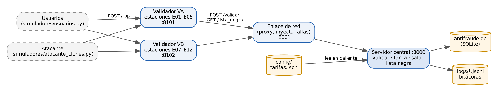

# RECAUDO-T – Atributos de calidad, Parte 2 (práctica)

Variante **V5 – Ola de fraudes** (Seguridad prioritaria, Disponibilidad secundaria).

Este repositorio implementa tres tácticas sobre un RECAUDO-T simulado con procesos
reales que se comunican por HTTP, y los experimentos que las miden contra una línea
base sin la táctica.

| Escenario | Atributo | Táctica implementada | Dónde está |
|---|---|---|---|
| S1 – Clonación de tarjetas | Seguridad (prioritario) | Detectar ataques (uso imposible por velocidad) + revocar acceso (lista negra) | `recaudo/antifraude.py` |
| D2 – Validador sin red | Disponibilidad (secundario) | Reintentar (cola local persistente, reenvío con espera exponencial, idempotencia por `tx_id`) | `recaudo/validador.py` |
| M1 – Cambios de tarifa | Modificabilidad | Diferir el enlace (reglas en `config/tarifas.json`, recarga en caliente) | `recaudo/tarifas_config.py` |

Compromiso medido: **Seguridad vs. Desempeño** (latencia que agrega la detección de S1).

> En la Parte 1 se había seleccionado P1 con la táctica *Introducir concurrencia*.
> La regla 2 de la Parte 2 no la acepta (ya se implementó en los talleres), por eso
> el tercer escenario es M1. El compromiso Seguridad–Desempeño se mide igual.

Ninguna táctica se importa de una librería: todo usa solo la librería estándar de
Python (`http.server`, `http.client`, `sqlite3`, `json`, `threading`).

## Requisitos

- Python 3.10 o superior.
- Opcional: `pip install matplotlib` para que se dibujen las gráficas.

## Comando único

```bash
python run.py                 # levanta el sistema completo (Ctrl+C para detener)
python run.py experimentos    # corre TODOS los experimentos y genera evidencias/ (~15 min)
python run.py pruebas         # pruebas de regresión (tarifas y antifraude)
```

También se puede correr un solo experimento: `python run.py experimentos s1`
(opciones: `m1`, `s1`, `d2`, `compromiso`).

Con Docker (alternativa): `docker compose up --build`.

Con el sistema arriba se pueden lanzar los simuladores a mano:

```bash
python -m simuladores.usuarios --tarjetas 50
python -m simuladores.atacante_clones --clonadas 20
```

## Procesos

| Proceso | Puerto | Real o simulado | Qué hace |
|---|---|---|---|
| `recaudo.central` | 8000 | real | Valida, calcula tarifa, descuenta saldo, motor antifraude, lista negra |
| `recaudo.enlace` | 8001 | real | Proxy de red entre validadores y central; permite inyectar la caída del enlace |
| `recaudo.validador` (VA, VB) | 8101, 8102 | real | Validadores embarcados; cola local y reintento; lista negra local |
| `simuladores/usuarios.py` | – | simulado | Usuarios legítimos con tiempos de viaje realistas |
| `simuladores/atacante_clones.py` | – | simulado | Atacante que usa tarjetas clonadas |
| `simuladores/carga.py` | – | simulado | Generador de carga de lazo abierto que registra cada solicitud |



## Estructura

```
recaudo/        código del sistema (central, validador, enlace, tácticas)
simuladores/    usuarios, atacante y generador de carga
experimentos/   un script por experimento + gráficas
config/         estaciones y tarifas (la tabla de tarifas es la de M1)
tests/          pruebas de regresión
evidencias/     CSV, bitácoras, diffs, resultados y gráficas de cada experimento
docs/           diagramas y documento de resultados
```

## Evidencias

Cada experimento deja, para la línea base y para la táctica:

- `evidencias/s1/*/solicitudes.csv`, `seguridad.jsonl` (bitácora), `resultado.json`
- `evidencias/d2/*/toques.csv`, `muestras_cola.csv`, `validador_VA.jsonl`, `enlace.jsonl`, `central_tx.jsonl`
- `evidencias/m1/*/cambio.diff` (el cambio exacto en el código o en la configuración), `consultas.csv`
- `evidencias/compromiso/*_repN/latencias.csv`, `corridas.csv`
- `evidencias/resumen.json` (todos los números del documento) y `evidencias/graficas/`

## Simplificaciones

- Los saldos viven en memoria del central; cada tarjeta simulada arranca con 500 000 pesos.
- El reloj de los eventos (`ts`) es simulado, para poder representar una hora de viajes
  en unos segundos. Las latencias y tiempos de detección se miden con el reloj real.
- Dos validadores representan la red; cada uno atiende seis estaciones.
